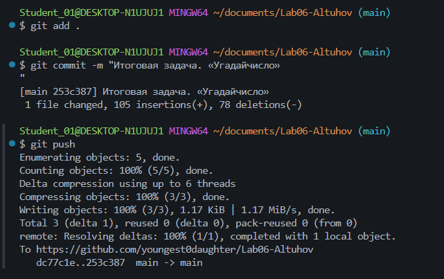
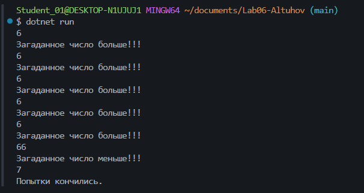

# Практическая работа №6

**ФИО:** Алтухов Павел
**Группа:** ИСП-241
**Дата:** 18.11.2026

## Что изучено
- Научился использовать циклы `for`, `while` и `do while` для повторения действий в программе в зависимости от задачи.
- Освоил паттерны накопления суммы и подсчёта количества подходящих элементов с помощью переменных-счётчиков внутри цикла.
- Понял разницу между операторами `break` и `continue`.

